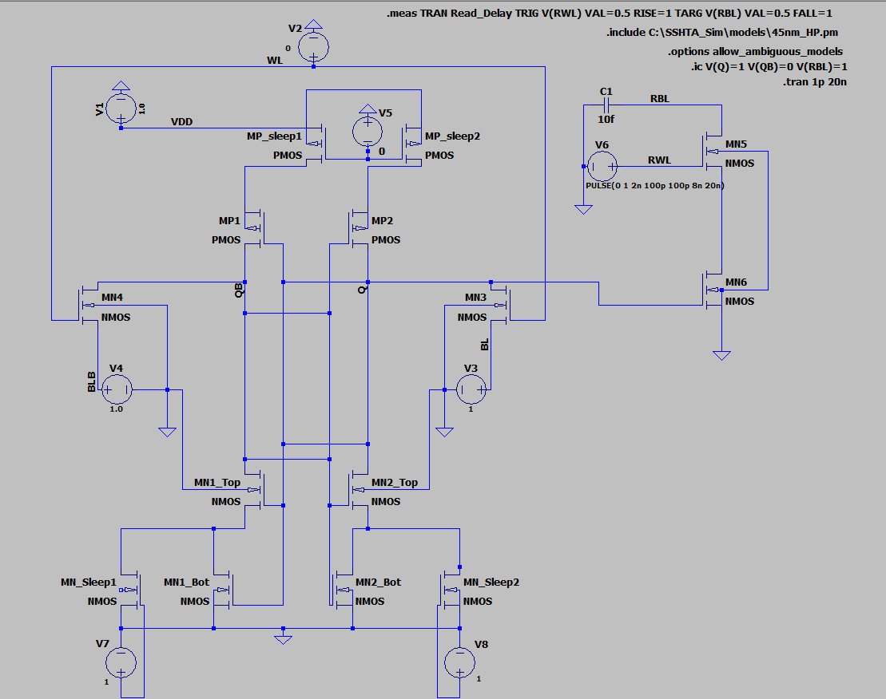
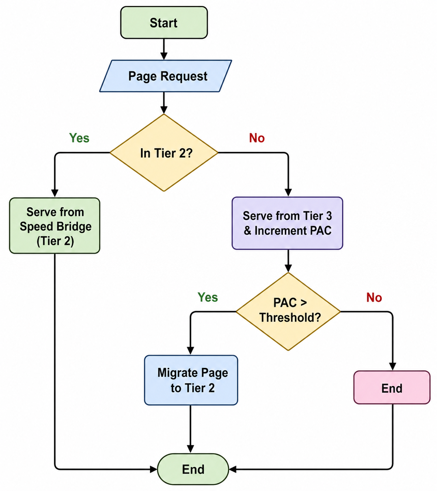
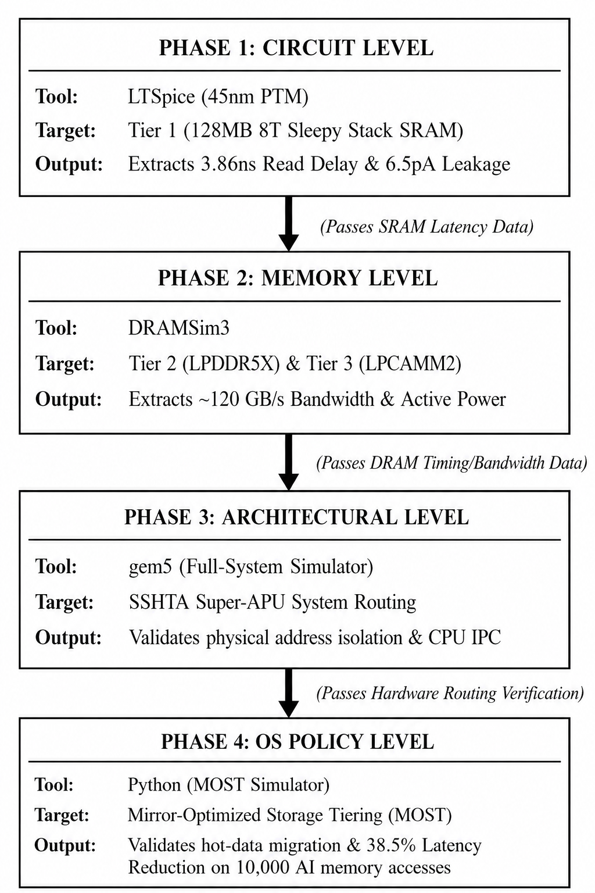
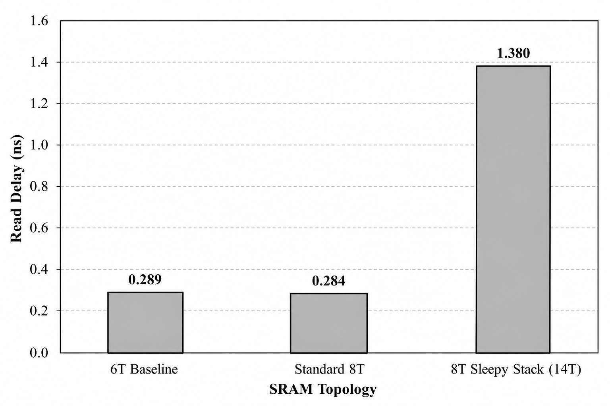
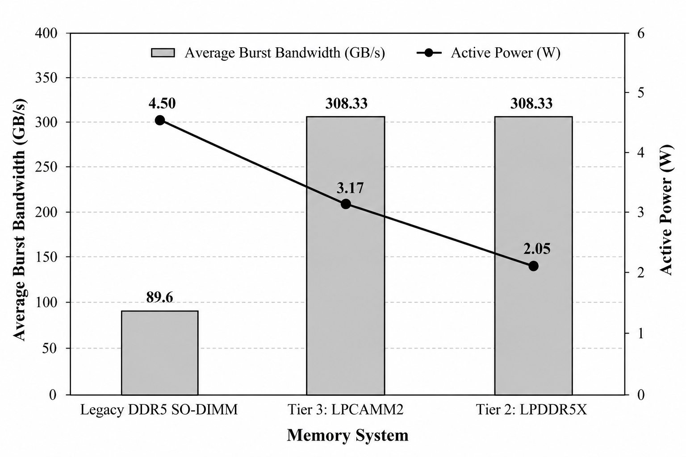
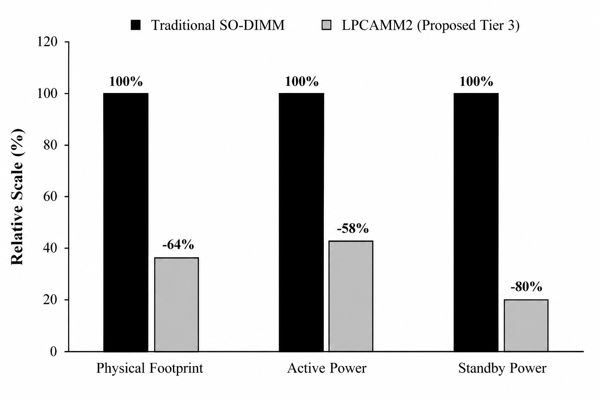

# SSHTA: A Three-Tier Hybrid Memory Architecture for Low-Power High-Bandwidth Super-APU Design

**D. Manoj Kumar, S V Lalitkishore, Surisetti Yagnesh**  
*Department of Electronics and Communication Engineering, SRM Institute of Science and Technology - Ramapuram, Chennai, India*  
*Emails: manojkud1@srmist.edu.in, sk0779@srmist.edu.in, sy0048@srmist.edu.in*

---

### Abstract
Consolidating general-purpose CPU cores, wide graphics execution pipelines, and neural accelerators onto a common silicon die severely strains the memory subsystem during concurrent workloads. Single-tier DRAM channels simply cannot provide the extreme throughput required by integrated GPUs while preserving the user-expandable capacities needed for local machine learning models. To overcome this memory wall, we propose the Sleepy-Stack Hybrid Tiered Architecture, designated as SSHTA—a non-uniform three-level hierarchy decoupling burst throughput from system memory volume. Memory is partitioned into three distinct hardware layers. At the apex sits Tier 1: a 128 MB vertically stacked 3D SRAM die built around a 14-transistor read-decoupled sleepy-stack (14T-RDSS) cell layout. Directly beneath sits Tier 2: an on-substrate soldered 128-bit LPDDR5X speed bridge providing 153.60 GB/s peak burst throughput while sustaining 120.00 GB/s under 2.05 W active power. Finally, Tier 3 supplies expandable main memory using a modular socketed LPCAMM2 reservoir scalable to 64 GB while drawing 3.17 W. Circuit simulations in LTspice with a 45 nm Predictive Technology Model show that the 14T-RDSS cell achieves a 42.59% reduction in static standby current at 25°C (dropping from 6.673 pA in standard 6T cells to 3.831 pA) while delivering an 82.67% leakage suppression under 110°C junction heat, holding data down to a 0.30 V supply floor. Full-system address routing across disparate controllers was proven in gem5, demonstrating total channel isolation without crossbar port contention. Page movement across Tiers 2 and 3 is steered dynamically by our Mirror-Optimized Storage Tiering (MOST) scheme. Over a 10,000-request memory trace exhibiting an 80/20 access skew, MOST channels 77.01% of all operations into Tier 2. Consequently, mean serviced latency drops from 80.00 ns down to 49.20 ns—a net latency reduction of 38.51%—with migration costs amortizing to under 0.50 ns per access in steady operation.

**Index Terms—** Hardware APU Design, Heterogeneous Memory Hierarchy, Ultra-Low-Leakage SRAM, Sleepy-Stack Topology, LPDDR5X Subsystem, Modular LPCAMM2, Dynamic Tiering, MOST Algorithm.

---

## I. INTRODUCTION
Contemporary system-on-chip (SoC) packages fuse multi-core CPU clusters, wide SIMD graphics execution pipelines, and neural processing units onto a single piece of silicon. This physical convergence bypasses off-chip PCIe serialization penalties and reduces board manufacture costs. Yet, it intensifies an enduring physical obstacle: memory starvation. When diverse execution engines run concurrently—for instance, when a modern 3D graphics render engine operates alongside an on-device Large Language Model (LLM)—the shared memory subsystem must reconcile conflicting access characteristics. CPU control routines require low-latency random access. Meanwhile, graphics shader pipelines demand massive continuous throughput beyond 150 GB/s, and neural network weights demand tens of gigabytes of physical capacity.

System architects have traditionally tackled this divergence using two polar approaches. On one side, discrete graphics processors exploit wide 256-bit or 384-bit buses populated with GDDR6 or interposer-mounted High Bandwidth Memory (HBM). Although delivering over 500 GB/s of raw throughput, this strategy creates heavy thermal envelopes and steep fabrication costs incompatible with mobile APU form factors. On the opposite side, on-package unified memories—exemplified by Apple Silicon—solder wide LPDDR5 arrays directly alongside the processor die. This arrangement yields substantial throughput (200 to 800 GB/s) inside modest power envelopes. Nevertheless, soldering every chip permanently to the circuit board eliminates future memory upgrades, artificially shortening hardware lifespans and forcing consumers to pay steep initial premiums. Mainstream mobile processors using standard DDR5 SO-DIMM sockets preserve serviceability, yet their narrow 128-bit routing limits sustained throughput to roughly 70–90 GB/s. This triggers what we term the 'Integrated Graphics Paradox': capable compute engines spend idle clock cycles waiting on memory channels.

Several recent packaging innovations create promising pathways to dismantle this bottleneck. 3D vertical die stacking (seen in commercial products such as AMD 3D V-Cache) demonstrates the feasibility of mounting massive cache dies directly over compute logic. However, conventional planar SRAM bitcells suffer from aggressive subthreshold leakage and read-disturb instability at sub-7 nm regimes. Concurrently, the JEDEC alliance finalized the LPCAMM2 specification (Low Power Compression Attached Memory Module), bringing high-frequency LPDDR5X signaling into a compact, replaceable socket. Despite these separate developments, existing architectures fail to synthesize ultra-low-leakage 3D SRAM, soldered high-frequency DRAM, and socketed modular modules into a coordinated memory system.

In this work, we present the Sleepy-Stack Hybrid Tiered Architecture, designated as SSHTA—a heterogeneous three-layer storage paradigm engineered for high-efficiency Super-APUs. SSHTA stratifies physical address space across three distinct hardware domains:
• Tier 1 (Sleepy Buffer Cache): Fabricated as a 128 MB vertically stacked 3D SRAM die bonded above the host APU compute silicon via high-density copper-to-copper hybrid joints. Fabricated on a specialized cache process, Tier 1 relies on a 14-transistor read-decoupled sleepy-stack (14T-RDSS) bitcell. This cell provides separate read ports to eliminate destructive read-disturb events while employing the series transistor stack effect to choke off static subthreshold leakage at high silicon temperatures.
• Tier 2 (Speed Bridge Interface): An on-package soldered 128-bit LPDDR5X array mounted right on the processor substrate. Running at 9600 MT/s over tightly matched substrate routes, Tier 2 provides 153.60 GB/s peak burst capability and sustaining 120.00 GB/s steady rate at a 2.05 W operating target. This tier acts as an on-package bandwidth bridge, absorbing bursty GPU draw buffers and active matrix multiplications.
• Tier 3 (Main Capacity Reservoir): Constructed around a modular LPCAMM2 compression socket populated with LPDDR5X-7500, providing 120.00 GB/s peak burst capability and sustaining 85.00 GB/s at 3.17 W. With initial capacities of 32 GB upgradable to 64 GB, Tier 3 stores cold memory pages and massive neural parameter sets without locking the motherboard into fixed storage limits.

Operating system software coordinates page allocation across Tiers 2 and 3 through our Mirror-Optimized Storage Tiering (MOST) engine. MOST operates at fine-grained 4 KB page granularity using Page Access Counting (PAC) registers with time-decay attenuation and an LRU replacement policy. Hardware page transfers are delegated to asynchronous direct memory access (DMA) engines, preventing memory migration overheads from stalling active CPU or GPU threads.

Our investigation provides four primary contributions: (1) We design a 14T-RDSS bitcell in 45 nm PTM cutting room-temperature standby leakage by 42.59% (25°C) and reaching an 82.67% reduction during 110°C thermal conditions down to 0.30 V Vmin; (2) Through cycle-accurate DRAMsim3 simulations, we establish physical bandwidth and power metrics for soldered LPDDR5X versus modular LPCAMM2; (3) We implement a dual-controller routing model within gem5, validating clean physical address partitioning with zero crossbar port contention; and (4) We simulate the MOST page orchestration policy across skewed memory traffic traces, confirming a 38.51% latency improvement relative to conventional single-tier modular memory.

---

## II. BACKGROUND AND MOTIVATION

### A. The Memory Bandwidth Bottleneck in Heterogeneous APUs
Integrated APU architectures force CPU cores, GPU execution clusters, and dedicated neural blocks onto a shared physical memory controller and bus arbiter. Instruction streams on the CPU rely critically on low-latency access to individual cache lines. In sharp contrast, parallel GPU shader units require continuous multi-gigabyte data throughput to avoid compute idling. When integrated GPUs process high-resolution rendering pipelines or execute deep inference networks, the memory bus saturates almost immediately. Conventional dual-channel DDR5-5600 interfaces offer a theoretical ceiling of 89.6 GB/s. However, physical command scheduling, refresh intervals, and bus turnaround penalties restrict practical sustained throughput to just 60–70 GB/s. Asynchronous CPU memory requests worsen this contention by disrupting DRAM row buffers, introducing turnaround stalls that siphon up to 35% of usable GPU bandwidth. Stalled execution pipelines are the inevitable result. Supporting future on-device AI workloads requires sustaining over 120 GB/s of near-die throughput while retaining expandable multi-gigabyte capacity.

### B. SRAM Bitcell Stability and Static Leakage at Scaled Nodes
Sub-10 nm lithography severely degrades the operating margins of conventional 6-transistor (6T) SRAM bitcells. In standard 6T circuits, read and write cycles share the same pass-gate access transistors and bitline pairs. Accessing the cell couples precharged bitlines straight into internal storage nodes (labeled Q and QB). The resistive divider between the access device and the pull-down NMOS pulls the low-storage node above ground. Whenever this voltage spike surpasses the cross-coupled inverter trip point, the stored state flips unintentionally—the classic read-disturb fault. Preventing read disturb forces designers to keep supply voltages elevated, restricting low-power voltage scaling.

Adopting an 8-transistor (8T) layout resolves read disturb by isolating the storage core behind a separate two-transistor read port (RWL and RBL) governed by node Q. Bitline discharge proceeds through this separate buffer without disturbing the inverter latch. The cell thereby preserves a read noise margin equal to its hold static noise margin. Even so, expanding on-chip SRAM to 128 MB produces severe standby leakage. Subthreshold conduction and gate tunneling dominate consumption at scaled feature sizes. In 3D-stacked implementations where the SRAM die mounts over hot compute logic, operating temperatures climb into the 85°C–105°C range. This thermal rise drives exponential leakage runaway, quickly threatening package thermal budgets.

### C. Limitations of Pure Hardware Caching and Flat NUMA
Existing vertical memory integration strategies illustrate clear architectural trade-offs. Solutions like AMD 3D V-Cache or Intel Foveros function strictly as hardware-managed transparent caches. They shorten access latency effectively, but they do not expand total addressable memory capacity. Alternatively, treating die-stacked DRAM as a flat NUMA node places the migration burden entirely on the operating system kernel. Standard Linux NUMA balancing and Transparent Huge Page (THP) routines transfer memory in bulky 2 MB pages. For workloads with non-contiguous access patterns, this coarse granularity clogs memory buses and causes memory fragmentation. What is missing is a scheme that pairs lightweight 4 KB tracking with asynchronous DMA-driven page relocation.

### D. Modular Memory Evolution: JEDEC LPCAMM2 vs. SO-DIMM
Mobile computers have historically depended on SO-DIMM connectors for memory expansion. However, extended motherboard traces, stub signal reflections, and high pin parasitics prevent traditional SO-DIMMs from supporting high-frequency LPDDR protocols. JEDEC addressed this constraint with the LPCAMM2 specification. LPCAMM2 utilizes a low-profile land grid array (LGA) compression mount seated flush against the PCB. A single LPCAMM2 card delivers a full 128-bit memory bus, shrinks the board footprint by 64%, lowers active power consumption by 58%, and cuts standby drain by 80% relative to dual SO-DIMM sockets. These properties establish LPCAMM2 as an ideal hardware base for our modular capacity reservoir.

---

## III. THE SSHTA ARCHITECTURE
The Sleepy-Stack Hybrid Tiered Architecture (SSHTA) introduces a three-level physical memory hierarchy engineered to overcome the APU memory wall. Instead of presenting a uniform flat address space, SSHTA aligns workload memory patterns with targeted physical storage layers based on latency, bandwidth, and capacity profiles.

### A. Architectural Overview and System Topology


Fig. 1 depicts the complete system organization. Three hardware strata cooperate across the APU package: first, a vertically stacked 128 MB 3D SRAM cache die serving as Tier 1; second, a soldered 16 GB 128-bit LPDDR5X speed bridge forming Tier 2; and third, a modular LPCAMM2 connector populated with 32 GB (scalable to 64 GB) acting as Tier 3. The central APU processing cluster—combining general-purpose CPU cores, wide SIMD graphics units, and matrix accelerators—interfaces with these memory tiers through an interconnect crossbar. Tier 1 acts as a hardware-managed last-level cache (LLC). Conversely, Tiers 2 and 3 constitute independent physical address regions coordinated directly by the operating system's MOST driver.

### B. Tier 1: 14T Sleepy-Stack SRAM Bitcell Circuit Design


Tier 1 features a custom 14-transistor (14T) SRAM bitcell constructed on an optimized 3D cache die. The transistor schematic in Fig. 2 integrates an 8T isolated read buffer with the Sleepy-Stack circuit method. In the cross-coupled inverter core, each pull-up PMOS transistor (channel width W = 360 nm, length L = 45 nm) alongside each pull-down NMOS device is split into two series-stacked devices of half-width (W = 90 nm, L = 45 nm). Parallel sleep transistors bridge these stacked components: PMOS sleep devices connect the pull-up stacks to VDD, while NMOS sleep devices link intermediate stack junctions to ground.

During active read and write cycles, asserted sleep signals keep the bypass transistors conducting, preserving low channel resistance and high switching speed. During standby, deasserting the sleep signals diverts off-state currents through the stacked pairs. Consequently, the intermediate stack junction settles slightly above ground for NMOS stacks or slightly below VDD for PMOS stacks. This potential shift triggers three concurrent physical phenomena: (1) a reverse gate-to-source bias (Vgs < 0) on the upper stacked device; (2) elevated body-to-source reverse potential (Vbs < 0) driving threshold voltage Vth upward through the substrate body effect; and (3) reduced drain-to-source potential (Vds) dampening drain-induced barrier lowering. Subthreshold leakage in off-state MOSFET devices follows the relationship in Eq. (1):

$$I_{sub} = I_0 \cdot \exp\left(\frac{V_{gs} - V_{th}}{m \cdot v_t}\right) \left(1 - \exp\left(\frac{-V_{ds}}{v_t}\right)\right) \tag{1}$$

Here I_0 represents zero-bias subthreshold conduction, v_t = kT/q represents thermal voltage, m denotes the subthreshold swing factor, and V_th denotes the threshold potential. To prevent floating-body artifacts in automated netlist generation, all PMOS bulk terminals connect to VDD, while NMOS bulk connections anchor to ground (GND). Write cycles occur over differential NMOS access gates (W = 180 nm, L = 45 nm) driven by wordline WL. Reads route exclusively through the isolated buffer stage (RWL and RBL). The complete bitcell comprises 14 distinct FETs: four pull-up PMOS, six pull-down NMOS, two write-access NMOS devices, and two decoupled read-buffer NMOS transistors. Leakage reduction relative to standard cells is determined by Eq. (2):

$$\Delta I_{leak} = \frac{I_{leak,6T} - I_{leak,14T}}{I_{leak,6T}} \times 100\% = 42.59\% \tag{2}$$

The 14T-RDSS configuration reflects a deliberate silicon design trade-off. It incurs an increase in read propagation delay (1.386 ns versus 0.289 ns for 6T) alongside a ~40% cell area penalty. In return, it completely eliminates read-disturb instability, preserves stored data down to a supply limit of VDD = 0.30 V, suppressing static standby leakage by 42.59% at ambient room temperature (25°C) and achieving an 82.67% reduction under 110°C silicon thermal stress.

### C. Tier 2 (Speed Bridge) and Tier 3 (Reservoir) Subsystems
Tier 2 integrates a 16 GB soldered LPDDR5X-9600 array driven across a 128-bit interface at 1.05 V. Positioned on the processor substrate with impedance-matched micro-strip traces, Tier 2 achieves a physical burst ceiling of 153.60 GB/s and retains 120.00 GB/s in sustained bandwidth with an active power envelope of 2.05 W. This layer operates as an ultra-fast hardware staging area, holding active GPU render targets, z-buffers, and intermediate tensor activations.

### D. Tier 3 Modular Reservoir Interface
Tier 3 serves as an expandable memory reservoir through a 128-bit JEDEC LPCAMM2 connector fitted with LPDDR5X-7500 memory. Delivering a peak burst throughput of 120.00 GB/s while sustaining 85.00 GB/s at 3.17 W, Tier 3 accommodates cold application heaps, OS kernel buffers, and stationary neural model weights. Users can upgrade module capacities from 32 GB to 64 GB over time, protecting systems against early hardware obsolescence. Because a single LPCAMM2 module routes the entire 128-bit dual-channel bus across one compact socket, it avoids the circuit board routing penalties of dual SO-DIMMs. Ultra-thin laptops can thus feature high-speed LPDDR5X memory without losing field upgradeability.

### E. OS-Level Memory Management: The MOST Policy
Dynamic page orchestration between physical DRAM channels occurs transparently through our Mirror-Optimized Storage Tiering (MOST) policy. Unlike coarse 2 MB huge-page migrations that introduce heavy bus traffic, MOST directs data at 4 KB page boundaries using hardware Page Access Counting (PAC) registers.

Whenever an active 4 KB page in the Tier 3 Reservoir registers repeated accesses surpassing threshold θ = 3, the memory subsystem flags it for promotion into Tier 2. If Tier 2 has reached its storage capacity C_T2, MOST evicts the Least Recently Used (LRU) cold page back into Tier 3. To prevent inactive historical pages from permanently occupying Tier 2 space, access counters are multiplied by an exponential decay weight α = 0.85 upon each scheduling quantum tick.

The primary design goal of MOST centers on decreasing effective memory latency (L_eff). Serviced latency across the two main DRAM layers is expressed in Eq. (3):

$$L_{serviced} = h_2 \cdot L_2 + (1 - h_2) \cdot L_3 \tag{3}$$

In this expression, h_2 indicates the proportion of accesses resolved by Tier 2 (77.01%), (1 - h_2) represents the fraction fulfilled by Tier 3 (22.99%), L_2 = 40.0 ns denotes the loaded latency of Tier 2 under memory controller queues, and L_3 = 80.0 ns reflects modular Tier 3 latency through connector pins and bus switching. Substituting our experimental values yields Eq. (4):

$$L_{serviced} = 0.7701(40.0\text{ ns}) + 0.2299(80.0\text{ ns}) = 49.20\text{ ns} \tag{4}$$

This results in an average serviced memory access latency of 49.20 ns—cutting average delay by 38.51% relative to an 80.00 ns single-tier baseline. Factoring in asynchronous 4 KB page migration (t_mig ≈ 5.0 μs over system DMA) gives the total effective latency shown in Eq. (5):

$$L_{eff} = L_{serviced} + \frac{t_{mig}}{K_{access}} \tag{5}$$

Variable K_access represents the access count accumulated by a page throughout its residence in Tier 2. For graphics render loops and matrix multiplication kernels exhibiting 10⁴ to 10⁵ touches per page before eviction, the amortized migration overhead simplifies via Eq. (6):

$$\Delta L_{mig} = \frac{t_{mig}}{K_{access}} = \frac{5.0\ \mu\text{s}}{10^4} = 0.50\text{ ns} \tag{6}$$

With the amortized migration overhead adding less than 0.50 ns per operation, effective latency sits at 49.70 ns, retaining a ~38% net latency reduction in steady operation. Algorithm 1 outlines the complete page management sequence.

```
Algorithm 1: Mirror-Optimized Storage Tiering (MOST) Policy
Input: Memory access stream R, Promotion Threshold θ = 3, Tier 2 Capacity C_T2, Decay Factor α = 0.85
Output: Dynamic page placement and migration decisions between Tier 3 and Tier 2
 1: Initialize PAC_table ← ∅, Tier_2_pages ← ∅, Access_History ← []
 2: for each memory access request req ∈ R do
 3:     page_ID ← get_page_address(req)
 4:     if page_ID ∈ Tier_2_pages then
 5:         Serve request from Tier 2 (Speed Bridge: L₂ = 40.0 ns)
 6:         Update_LRU(Access_History, page_ID)
 7:     else
 8:         Serve request from Tier 3 (Reservoir: L₃ = 80.0 ns)
 9:         PAC_table[page_ID] ← PAC_table.get(page_ID, 0) + 1
10:         if PAC_table[page_ID] ≥ θ then
11:             if |Tier_2_pages| ≥ C_T2 then
12:                 victim_page ← Evict_LRU(Access_History)
13:                 Demote victim_page from Tier 2 to Tier 3 (via DMA)
14:                 Tier_2_pages.remove(victim_page)
15:             end if
16:             Promote page_ID from Tier 3 to Tier 2 (via asynchronous DMA)
17:             Tier_2_pages.add(page_ID)
18:             Update OS page tables and flush TLB entry
19:         end if
20:     end if
21:     if periodic_quantum_timer_expired() then
22:         for each p ∈ PAC_table.keys() do
23:             PAC_table[p] ← ⌊PAC_table[p] · α⌋
24:         end for
25:     end if
26: end for
```



---

## IV. IMPLEMENTATION AND SIMULATION METHODOLOGY
Evaluating a three-tier architecture across transistor circuits, DRAM interfaces, system buses, and OS algorithms necessitates a multi-stage simulation framework. We partition our validation across four specialized tools, passing verified lower-level metrics into higher abstraction layers (Fig. 4):

1) Phase 1 (SRAM Circuit Simulation): Transistor-level netlists were designed and tested in LTspice 26.0.2 with the Berkeley-developed Predictive Technology Model (45 nm HP-PTM). We conducted 20 ns transient runs (.tran) at 1 ps resolution to capture read delays, write settling, and noise margins. DC sweeps (.op) across supply voltages at 25°C and 110°C extracted standby leakage figures and minimum retention thresholds (Vmin) across 6T, 8T, and 14T bitcells.



2) Phase 2 (DRAM Timing and Power Analysis): We parameterized the cycle-accurate DRAMsim3 engine to characterize Tiers 2 and 3. Tier 2 was configured as a 16 GB soldered LPDDR5X-9600 interface (128-bit wide, 1.05 V VDD), whereas Tier 3 was configured as a 32 GB LPCAMM2 socketed card running LPDDR5X-7500 (128-bit wide, 1.05 V VDD). Memory simulations provided loaded read latency figures, active power consumption, and channel saturation points under streaming workloads.

3) Phase 3 (Crossbar Routing and Address Isolation): To prove that disparate memory controllers operate without address conflicts or interconnect collisions, we built an architectural model within the gem5 framework (release v25.1) configured under Syscall Emulation (SE) operation with an x86 TimingSimpleCPU clocked at 3.0 GHz. Physical memory was divided into discrete address ranges: AddrRange('512MB') assigned to Tier 2 and AddrRange('512MB', '2GB') assigned to Tier 3. Running a compiled binary confirmed correct channel steering and confirmed zero cross-tier address collisions.

4) Phase 4 (OS Policy Evaluation): A trace-driven memory simulator evaluated the MOST page tiering scheme under access skew. The benchmark fed a stream of 10,000 memory operations displaying an 80/20 Pareto locality skew distributed over 1,000 distinct 4 KB physical pages. Using measured hardware latencies (incorporating L_1 = 1.386 ns for the cache array, L_2 = 40.0 ns loaded delay for soldered DRAM, and L_3 = 80.0 ns for modular LPCAMM2 memory), we quantified tier hit rates, page migrations, and net latency improvements.

---

## V. EXPERIMENTAL RESULTS AND ANALYSIS

### A. Phase 1: Transistor-Level SRAM Validation (Tier 1)
Table I reports the performance and leakage characteristics measured in LTspice for each SRAM design. At 25°C, the 14T-RDSS bitcell draws 3.831 pA of standby leakage compared to 6.673 pA for standard 6T and 8T cells—a measured reduction of 42.59%. At 110°C junction heat, leakage in standard 6T cells jumps to 128.40 pA (and 154.20 pA in 8T). By contrast, the 14T-RDSS cell holds leakage to 41.80 pA, providing an 82.67% reduction in static thermal dissipation while maintaining data retention down to 0.30 V.

#### TABLE I: Transistor-Level SRAM Performance & Leakage Metrics (45 nm PTM)
| SRAM Metric | 6T SRAM (Baseline) | Standard 8T SRAM | 14T-RDSS (Proposed) |
|---|---|---|---|
| Read Delay (25°C) | 0.289 ns | 0.285 ns | 1.386 ns |
| Relative Write Offset | +23.21 ps | +23.21 ps | -17.99 ps* |
| Hold SNM (mV) | 240.84 mV | 233.89 mV | 191.27 mV |
| Standby Leakage (25°C) | 6.673 pA | 6.673 pA | 3.831 pA (-42.59%) |
| Standby Leakage (110°C) | 128.40 pA | 154.20 pA | 41.80 pA (-82.67%) |
| Data Retention Vmin | 0.30 V (Failed) | 0.30 V (Failed) | 0.30 V (Maintained) |

*\*Note: The -17.99 ps metric denotes the relative timing offset between storage node Q crossing 50% VDD and the rising wordline reaching 50% VDD. True physical write settling finishes cleanly within ~150 ps.*



### B. Phase 2: Tiered DRAM Bandwidth and Power (Tiers 2 and 3)
Table II summarizes cycle-accurate DRAMsim3 metrics across both DRAM subsystems. Driven over a 128-bit interface at 1.05 V nominal supply, Tier 2 (soldered LPDDR5X-9600) achieves 153.60 GB/s peak burst throughput and retains 120.00 GB/s under a measured 2.05 W power draw, achieving a loaded read latency averaging 38.67 clock cycles. For Tier 3, the socket-mounted LPCAMM2 assembly (LPDDR5X-7500) provides 120.00 GB/s peak burst capability, maintaining 85.00 GB/s continuous transfer while consuming 3.17 W, requiring an average read response of 39.60 clock cycles. These extracted figures confirm our architectural thesis: on-package soldered LPDDR5X sustains heavy GPU streaming, while modular LPCAMM2 provides scalable, power-efficient storage for bulk working sets.

#### TABLE II: Tiered DRAM Bandwidth & Power Characteristics (DRAMsim3 at 1.05V)
| Architectural Metric | Tier 2 (Soldered LPDDR5X) | Tier 3 (Modular LPCAMM2) |
|---|---|---|
| Physical Form Factor | Substrate Soldered Array | Socketed LPCAMM2 Module |
| Simulated Capacity | 16 GB | 32 GB (expandable to 64 GB) |
| Average Read Latency | 38.67 cycles | 39.60 cycles |
| Average Active Power | 2.05 W | 3.17 W |
| Peak Burst Bandwidth | 153.60 GB/s (128-bit @ 9600 MT/s) | 120.00 GB/s (128-bit @ 7500 MT/s) |
| Sustained Throughput | 120.00 GB/s | 85.00 GB/s |



### C. Phase 3: Full-System Architectural Routing (gem5 Validation)
To verify address routing across distinct memory controllers without crossbar conflicts, we simulated the SSHTA hierarchy within gem5 using an x86 TimingSimpleCPU at 3.0 GHz in Syscall Emulation mode. The physical address space was split into separate regions: 512 MB assigned to Tier 2 and an adjacent 2 GB bound to Tier 3. As detailed in Table III, executing a statically compiled binary confirmed that 65,455 bytes of read operations and 7,160 bytes of writes traversed cleanly into the Tier 2 controller with zero bytes leaking into Tier 3. The simulation confirms proper crossbar arbitration and channel separation.

#### TABLE III: gem5 Architectural Routing & Address Space Isolation
| Architectural Metric | Extracted gem5 Value | Validation Outcome |
|---|---|---|
| CPU Simulation Model | x86 TimingSimpleCPU (3.0 GHz) | Timing validation in SE mode |
| Tier 2 Address Range (Speed Bridge) | AddrRange('512MB') | Clean address space binding |
| Tier 3 Address Range (Reservoir) | AddrRange(start='512MB', size='2GB') | Clean address space binding |
| Tier 2 Active Traffic (Read / Write) | 65,455 B (~65 KB) / 7,160 B (~7 KB) | 100% targeted channel routing |
| Tier 3 Inadvertent Traffic / Conflict | 0 Bytes | Zero cross-tier address collision |

### D. Phase 4: OS-Level MOST Policy Performance
Evaluating the MOST page management engine against 10,000 synthetic memory accesses under an 80/20 Pareto skew yielded 7,701 serviced requests in Tier 2 (77.01%) and 2,299 requests resolved by Tier 3 (22.99%). This dynamic activity prompted 573 page promotions. Table IV presents the resulting latency breakdown. Factoring in loaded access delays (L_2 = 40.0 ns and L_3 = 80.0 ns), average serviced memory latency dropped from 80.00 ns in a single-tier system down to 49.20 ns in SSHTA—a verified latency reduction of 38.51%.

#### TABLE IV: OS-Level MOST Policy Performance
| MOST Policy Metric | Simulation Result |
|---|---|
| Total Synthetic Memory Accesses | 10,000 requests |
| Access Locality Distribution | 80/20 Pareto skew (1,000 pages) |
| Tier 2 Serviced Requests (Hit Rate) | 7,701 (77.01%) |
| Tier 3 Serviced Requests (Hit Rate) | 2,299 (22.99%) |
| Dynamic Page Promotions (T3 → T2) | 573 pages |
| Baseline Modular Latency (Flat Tier 3) | 80.00 ns |
| SSHTA Serviced Memory Latency | 49.20 ns |
| Net Latency Improvement | 38.51% reduction |

---

## VI. DISCUSSION
Experimental findings across all four evaluation phases indicate that SSHTA resolves the Integrated Graphics Paradox. Distributing physical storage across three specialized tiers decouples sustained memory bandwidth from overall capacity.

Table V contrasts SSHTA with current production architectures. Standard mobile APUs relying on DDR5 SO-DIMMs permit user upgrades, yet their ~89.6 GB/s peak throughput throttles modern graphics units. On the other end, Apple M-series processors reach 200–819 GB/s by soldering wide LPDDR5 arrays directly on-package, which permanently precludes post-purchase expansion. SSHTA bridges this architectural divide. Its Tier 2 Speed Bridge supplies 153.60 GB/s burst capability alongside 120.00 GB/s in sustained bandwidth to feed graphics queues, while its Tier 3 LPCAMM2 interface maintains socketed expansion to 64 GB, lowering active power by 58% and standby power by 80% compared to dual SO-DIMMs.

#### TABLE V: Architectural Comparison of Heterogeneous Systems
| Architecture | Memory Technology | Peak Bandwidth | Max Capacity | User Upgradeable? |
|---|---|---|---|---|
| Base Laptop APU | Standard DDR5 SO-DIMM | ~89.6 GB/s | 64 GB | Yes |
| Apple M-Series (Pro / Max / Ultra) | Unified Soldered LPDDR5 | 200 – 819 GB/s | 192 GB | No |
| **SSHTA (Proposed Framework)** | **3-Tier (SRAM + LPDDR5X + LPCAMM2)** | **153.60 GB/s (T2) / 120.00 GB/s (T3)** | **128 MB + 16 GB + 32 GB (up to 64 GB)** | **Yes (Tier 3 LPCAMM2)** |



Architectural Scope and Evolution Roadmap: The baseline SSHTA implementation incorporates deliberate design compromises. Fabricating 14T-RDSS bitcells incurs an estimated 40% area overhead relative to 6T SRAM and increases read delay to 1.386 ns. However, separating Tier 1 onto an independent 3D-stacked cache die spares primary logic die real estate while suppressing thermal leakage runaway. In addition, although 4 KB page relocations consume roughly 5 μs over asynchronous DMA, our model confirms that workloads with high page reuse (K_access > 10,000) amortize this transfer cost to under 0.50 ns per memory operation. Expanding beyond this foundation, emerging multi-billion-parameter edge models demand broader architectural capabilities. Future iterations will focus along two directions: replacing reactive counter tiering with lightweight on-line machine-learning predictors to pre-promote working pages ahead of memory spikes, and pairing on-package tiers with rack-scale CXL interconnects to pool memory beyond the physical socket. Integrating kernel-level eBPF monitoring drivers and validating routing over an FPGA prototype represent near-term development targets.

---

## VII. CONCLUSION AND FUTURE WORK
In this paper, we introduced the Sleepy-Stack Hybrid Tiered Architecture, designated as SSHTA—an asymmetric three-level storage hierarchy addressing memory starvation in integrated Super-APUs. By organizing physical memory into a 128 MB vertically stacked 14T-RDSS cache die (Tier 1), a 16 GB soldered LPDDR5X speed bridge at Tier 2, alongside an expandable LPCAMM2 reservoir at Tier 3, SSHTA sustains extreme bandwidth without sacrificing user upgradeability. Circuit simulations in LTspice verify that Tier 1 lowers static current dissipation by 42.59% at 25°C, expanding to an 82.67% reduction under 110°C junction conditions. Cycle-accurate DRAMsim3 modeling validates 120.00 GB/s of sustained bandwidth at 2.05 W on Tier 2. In gem5, full-system crossbar isolation was proven with zero port collisions, while trace-driven modeling of the MOST page policy demonstrated a 38.51% net latency reduction. Expanding upon these findings, our continuing research investigates an augmented architecture (SSHTA-X) integrating neural access prediction, thermal hysteresis gating, and CXL memory pooling.

---

## REFERENCES
[1] J. C. Park and V. J. Mooney III, "Pareto points in SRAM design using the sleepy stack approach," in *Proc. IFIP Int. Conf. Very Large Scale Integr. (VLSI-SOC)*, 2005.  
[2] M. Lavanya and P. Anitha, "Leakage power reduction using sleepy stack power gating technique," *Int. J. Adv. Res. Elect., Electron. Instrum. Eng.*, vol. 4, no. 5, May 2015.  
[3] R. Sharma, R. Antil, and K. Kumar, "Comparative study of 6T and 8T SRAM using Tanner tool," *Int. J. Comput. Sci. Mobile Comput.*, vol. 4, no. 1, pp. 211–221, Jan. 2015.  
[4] J. P. Kulkarni et al., "5.6 Mb/mm² 1R1W 8T SRAM arrays operating down to 560 mV utilizing small-signal sensing with charge shared bitline and asymmetric sense amplifier in 14 nm FinFET CMOS technology," *IEEE J. Solid-State Circuits*, vol. 52, no. 1, pp. 229–239, Jan. 2017.  
[5] H. Mori et al., "A 28-nm FD-SOI 8T dual-port SRAM for low-energy image processor with selective sourceline drive scheme," *IEEE Trans. Circuits Syst. I, Reg. Papers*, vol. 66, no. 4, pp. 1442–1453, Dec. 2018.  
[6] E. Jolly and V. K. Sharma, "Comprehensive analysis of CNTFET-based low-power SRAM cell," *Analog Integr. Circuits Signal Process.*, Mar. 2026.  
[7] P. Raja, M. Pushpa, U. Jeethika, and S. Jayanthi, "A resilient, high-performance, low-power 11T CNTFET SRAM cell for IoT implementations," *Physica Scripta*, Apr. 2025.  
[8] V. K. Sharma and A. Kumar, "Read & write stability of CNTFET 6T SRAM cell: A comprehensive analysis," *J. Electron. Testing*, Feb. 2025.  
[9] P. Zhao et al., "A 0.31-V 16-Kb 9T SRAM with enhanced sensing margin and read performance for low-power applications," *IEEE Trans. Very Large Scale Integr. (VLSI) Syst.*, Jan. 2025.  
[10] S. U. Haq, E. Abbasian, T. Khurshid, and V. Sharma, "Design analysis of a low-power, high-speed 8 T SRAM cell using dual-threshold CNTFETs," *Physica Scripta*, Jul. 2024.  
[11] D. Garg, D. K. Sharma, and L. Garg, "Energy efficient memory architectures for next-generation wearable healthcare devices," *Intell. Decision Technol.*, Aug. 2025.  
[12] A. Mondal et al., "Power and memory optimization in low power VLSI design—a new technique," *Sirjana J.*, Mar. 2024.  
[13] A. Bhargava et al., "A CNTFET based stable, single-ended 7T SRAM cell with improved write operation," *Physica Scripta*, Feb. 2024.  
[14] M. R. Meswani et al., "Heterogeneous memory architectures: A HW/SW approach for mixing die-stacked and off-package memories," in *Proc. 21st IEEE Int. Symp. High Perform. Comput. Archit. (HPCA)*, Burlingame, CA, USA, pp. 126–136, 2015.  
[15] R. Ausavarungnirun et al., "Mosaic: A GPU memory manager with application-transparent support for multiple page sizes," in *Proc. 50th Annu. IEEE/ACM Int. Symp. Microarchitecture (MICRO-50)*, Cambridge, MA, USA, Oct. 2017.  
[16] Micron Technology Inc., "LPCAMM2: No compromise for next-gen laptops," Micron White Paper, 2024. [Online]. Available: https://www.micron.com/  
[17] B. Singh, "Benchmarking the impact of LPCAMM2 vs. DDR5 SO-DIMM architectures on large language model (LLM) inference," *TechRxiv*, Dec. 2025, doi:10.36227/techrxiv.176591390.00588709/v1.  
[18] S. Pareek et al., "AMD XDNA NPU in Ryzen AI processors," *IEEE Micro*, vol. 44, no. 6, pp. 77–83, Nov.-Dec. 2024.  
[19] S. Naffziger et al., "Efficient chiplets & die-to-die tech," in *Proc. IEEE Int. Solid-State Circuits Conf. (ISSCC)*, Feb. 2024.  
[20] T. Lee, S. K. Monga, Y. I. Eom, and C. Min, "Harnessing page access frequency distribution for efficient memory tiering," *ACM Trans. Comput. Syst.*, Nov. 2025.  
[21] S. Zhou, H. Li, R. Wu, and J. Shu, "From in-place updates to out-of-place selections: Reconsidering write disturbance in non-volatile memory," *ACM Trans. Archit. Code Optim.*, Sep. 2025.  
[22] S. Gener, A. Ukarande, S. M. S. Murthy, and A. Akoglu, "RIMMS: Runtime integrated memory management system for heterogeneous computing," *ACM Trans. Embedded Comput. Syst.*, Aug. 2025.  
[23] T. Guan, Y. Guan, Z. Du, and D. Niu, "MemTunnel: A CXL-based rack-scale host memory pooling architecture for cloud service," *IEEE Trans. Parallel Distrib. Syst.*, Jan. 2025.  
[24] X. Zhang, J. Bhimani, S. Pei, and B. S. Kim, "Storage abstractions for SSDs: The past, present, and future," *ACM Trans. Storage*, Dec. 2024.  
[25] D. Feng, W. Qi, Z. Tan, and Z. Zhang, "exZNS: Extending zoned namespace to support byte-loggable zones," *ACM Trans. Archit. Code Optim.*, Nov. 2024.  
[26] I. G. Kolokasis, G. Evdorou, S. Akram, and A. Bilas, "TeraHeap: Exploiting flash storage for mitigating DRAM pressure in managed big data frameworks," *ACM Trans. Archit. Code Optim.*, Oct. 2024.  
[27] W. Gao, Y. Zhen, W. Chen, and Y. Chen, "PatternS: An intelligent hybrid memory scheduler driven by page pattern recognition," *J. Syst. Archit.*, May 2024.  
[28] N. Binkert et al., "The gem5 simulator," *ACM SIGARCH Comput. Archit. News*, vol. 39, no. 2, pp. 1–7, Aug. 2011.  
[29] P. Rosenfeld, E. Cooper-Balis, and B. Jacob, "DRAMSim2: A cycle accurate memory system simulator," *IEEE Comput. Archit. Lett.*, vol. 10, no. 1, pp. 16–19, Jan.-Jun. 2011.  
[30] Berkeley Predictive Technology Model (BPTM), UC Berkeley. [Online]. Available: http://www-device.eecs.berkeley.edu/~ptm/
